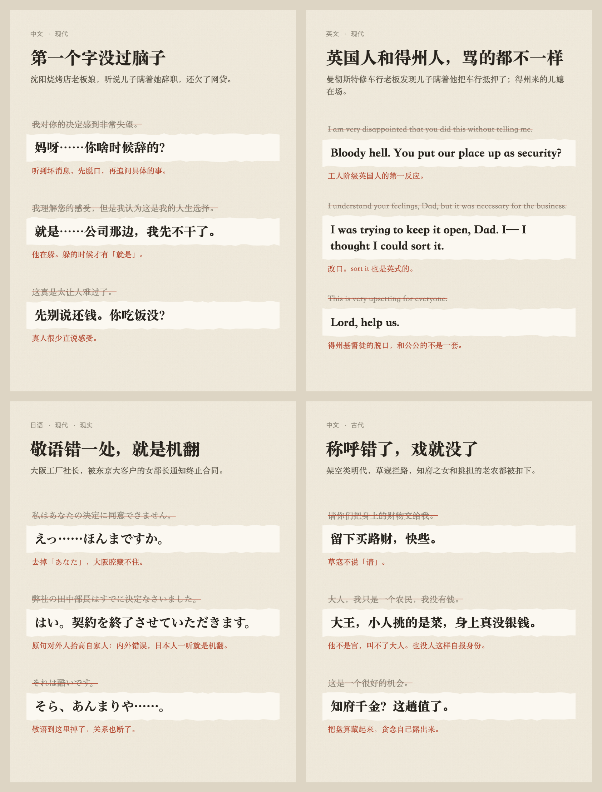
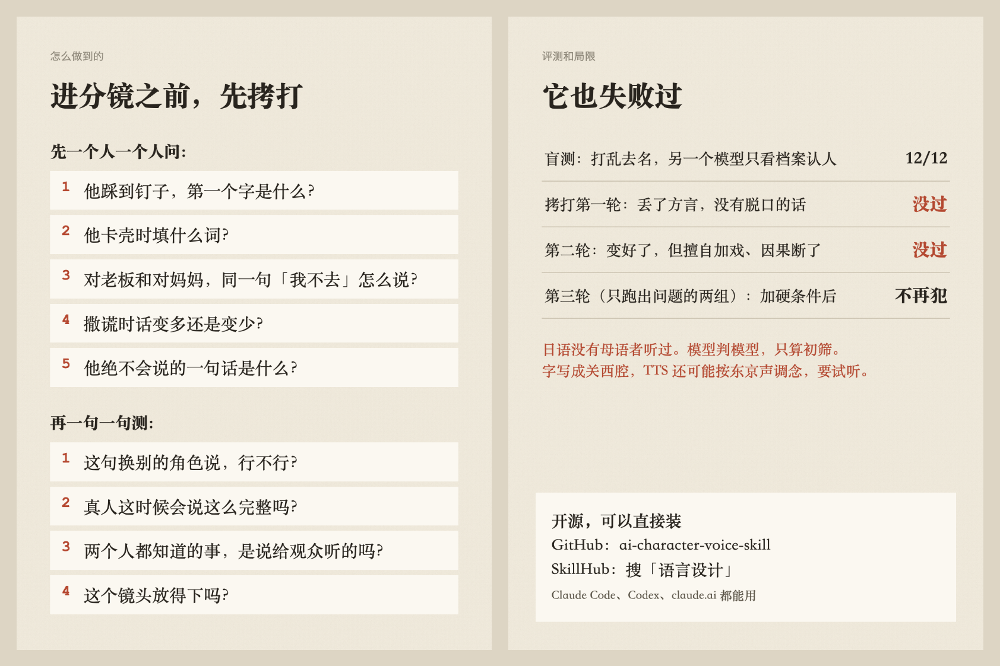

# AI 角色语言设计 Skill（yuyan-sheji）

> 人物一开口，露馅最快的就是台词。

律师、修理工、十四岁小孩，模型让他们说同一种客服腔：语法完整、用词中上、礼貌周到、谁说都行。这个 Agent Skill 给每个角色建一份**语言档案**，并在**剧本阶段**就逐人逐句拷打台词，让 AI 短片、短剧里的人说话接近真人。[Claude Code](https://claude.com/claude-code)、Codex、claude.ai 都能用。

[English summary](#english)

## 同一段对白，拷打前后



<details>
<summary>文字版</summary>

**沈阳烧烤店老板娘，听说儿子瞒着她辞职、还欠了网贷**

| 改前 | 改后 |
|---|---|
| 我对你的决定感到非常失望。 | 妈呀……你啥时候辞的？ |
| 这真是太让人难过了。 | 先别说还钱。你吃饭没？ |

**曼彻斯特修车行老板，发现儿子瞒着他把车行抵押了**

| 改前 | 改后 |
|---|---|
| I am very disappointed that you did this without telling me. | Bloody hell. You put our place up as security? |
| I understand your feelings, Dad, but it was necessary for the business. | I was trying to keep it open, Dad. I— I thought I could sort it. |

**大阪工厂社长，被东京大客户的女部长通知终止合同**

| 改前 | 改后 |
|---|---|
| 私はあなたの決定に同意できません。 | えっ……ほんまですか。 |
| 我々は二十年間一緒に仕事をしてきたのです。 | 二十年やで。ずっと一緒にやってきたやないですか。 |
| それは酷いです。 | そら、あんまりや……。 |

原稿还有一句「弊社の田中部長はすでに決定なさいました」：对外人抬高自家人，是日语敬语里的内外错误，拷打时直接抓出来。

**架空类明代，草寇拦路**

| 改前 | 改后 |
|---|---|
| 请你们把身上的财物交给我。 | 留下买路财，快些。 |
| 大人，我只是一个农民，我没有钱。 | 大王，小人挑的是菜，身上真没银钱。 |

</details>

## 它管什么

三根轴互相独立，组合都成立：

| 轴 | 选项 |
|---|---|
| 语言 | 中文、英文、日语 |
| 时代 | 现代、民国、古代（再定朝代）、架空（再定依托） |
| 风格 | 日语分现实和二次元；古代分考据、通行、戏说；黑帮、JK 这类经典角色分真实、影视、漫画三层 |

| 内容 | 有什么 |
|---|---|
| **日语** | 做日语视频时确保说的是对的：人称表（自称、对称、他称、谦称，标了现实里用不用）；敬语五分类和内外；男女对同辈、上级、下级的对象矩阵；现实已中性化的句末；役割语（大小姐语、老人语、武士语、魔王，おぬし、われ、わらわ）；黑帮、不良、热血少年、JK 的整套语言体系；关西腔（大阪、河内、京都、神户的语法对照，〜はる，词分三层，声调和 TTS 的坑）和其他地方口音；读音表和拍数 |
| **英文** | 英美澳词表和拼写，英国角色过四关；AAVE 语法规则；律师腔；U 和 non-U；夹法语和拉丁语 |
| **中文** | 京味儿、东北话、粤语夹英文、体制内、大厂黑话 |
| **古代** | 中文的帝王、官员、士人、官家女子、平民、商贾、草寇、僧道的称谓和古今替换表，先秦到民国的朝代差别表；明、清、民国细写（明代官场为什么不是一律「大人」，清代谁说奴才谁说臣，民国的新旧两套称呼，哪些是影视叫法）；英文的 thou 规矩和摄政时期称呼；日语的时代剧语 |
| **架空王朝** | 贴朝代、拼合、自造三档；全剧共用的称谓锁定表；真实历史算不算数（架空的国家里能不能说「三顾茅庐」） |
| **真人感（现代）** | 惊讶、愤怒时脱口而出的话，按语言、年龄、地域、信仰分（bloody hell、oh my goodness、卧槽、这下坏了）；分人群、分地区的 filler（like、literally、就是、那啥、なんか、ほんで）和密度，中英日三语都有；古代不细做 |

## 六个模式



| 模式 | 什么时候用 |
|---|---|
| **A 称谓纠偏** | 只想知道称呼对不对。中日英、古今都能用，不用建档，给一句台词也行。拿不准的不猜：直接问你，说清为什么拿不准、查了哪些信源，由你决定 |
| **R 剧本拷打** | 进分镜之前。逐个人物逼问（他踩到钉子第一个字是什么？），再逐句测（这句换人行不行？真人会说这么完整吗？说给观众听的吗？）。有 10 条出关硬条件 |
| S 从样本建档 | 手上有某人的访谈、口播稿 |
| P 从人设建档 | 手上有人设或小传，可以接[角色设计 skill](https://github.com/MatsuriMW/ai-character-design-skill) |
| W 写或改台词 | 已经有档案 |
| C 检查与回写 | 逐句打标签，把写对的新习惯回写进档案 |

## 评测

都是**模型判模型**，用例和每轮记录在 [`yuyan-sheji/evals/`](yuyan-sheji/evals/)。

**盲测**：四个角色各 3 句，打乱去名，另一个模型只看档案认人。

| 轮次 | 题 | 结果 |
|---|---|---|
| 第一轮（同一会话写台词） | 英文、中文 | 12/12 |
| 第二轮（换人写台词，换模型判卷） | 英文、中文 | 10/12 |
| 第三轮（按认错的句子补档案后） | 英文、中文 | 12/12 |
| 日语 | 现实风格四人 | 12/12 |
| 古代 | 平民、官家女子、官员、草寇 | 12/12 |

**拷打模式从零走**：另一个模型只拿到 skill，处理一段模型写的干净对白。这一项最有用，因为它真的失败过：

| 轮次 | 发现 | 怎么改的 |
|---|---|---|
| 第一轮 | 抓到内外错误，但成品是软的：设定写大阪人却不写大阪腔，没有脱口的话，三个人全程敬体，超长的句子只提醒不改 | 加出关硬条件 |
| 第二轮（中英日、古今四个组合） | 明显变好；但日语从 6 句加到 12 句，加了情节；古代删掉「我父亲是知府」后，下一句「知府千金？」接不上；两处都自评「通过」 | 加「不加戏」「连起来读因果」，要求自评写依据 |
| 第三轮（只跑出问题的两组） | 不再加戏，自己抓到多写的信息并删掉；因果接上了 | |

**脚本**：故意写错的（简体字、二重敬语、「行くですわ」、现实剧里的「おぬし」、古代台词里的「老公」「OK」）都抓到；写对的（言われて、我慢、山田君）不误报。

**这些评测不能说明的**：

- **日语没有经过母语者听校**。审校也是模型做的：低推理一轮报 12 条，确认 10 条；关西腔这份用高推理又审一轮，确信的 8 条都改了。正式发布的日语台词，请母语者听一遍，尤其是关西腔和时代剧语。
- **字写成关西腔，TTS 可能按东京声调念**。这是按引擎工作方式推的，还没有实测过，要自己试听。
- 盲测的角色反差大，题偏容易。
- 脚本查不出敬语方向和内外（最严重的错），这些要逐句人工过。
- 称谓的朝代细节、地域脏话、俚语年份有不少是常识整理，标了〔待核〕（见下面的[信源](#信源)）。

## 信源

做这个 skill 时实际参考过的资料。**这份资料大多只看了摘要或摘录，不要当成读过全文的文献综述**，规则里拿不准的都标了〔待核〕，对应关系和存疑见 [`references/sources.md`](yuyan-sheji/references/sources.md)。

标记：◎ 读了相关段落；○ 只看了摘要或搜索摘录；△ 审校模型引用的，我没有逐篇读。

<details>
<summary>日语：敬语、役割语、人称、句末</summary>

- ◎ 文化审议会，[《敬語の指針》](https://www.bunka.go.jp/seisaku/bunkashingikai/kokugo/hokoku/pdf/keigo_tosin.pdf)（2007）
- ◎ 国立国语研究所，[会話から日本語を見る](https://kotoba.ninjal.ac.jp/digest/03/d-03-05/)：同一个人对不同对象的自称
- ◎ 国立国语研究所，[おじいちゃんのような話し方](https://kotoba.ninjal.ac.jp/qa/yokuaru/qa-79/)：役割语的来历
- ○ 金水敏，[《ヴァーチャル日本語 役割語の謎》](https://www.iwanami.co.jp/book/b625302.html)（书的介绍）、[讲义](http://skinsui.cocolog-nifty.com/sklab/files/tallinnlecturekinsuihandout.pdf)、[短文](http://skinsui.cocolog-nifty.com/skinsuis_blog/2005/11/post_2ce1.html)、[研究者访谈](https://kotoba.ninjal.ac.jp/digest/04/d-04-05/)、[大阪大学介绍](https://resou.osaka-u.ac.jp/ja/story/2019/fyvba9)
- ○ 定延利之，[ことばとキャラ](https://dictionary.sanseido-publ.co.jp/column/zadankai03)、[「役割語」について](https://dictionary.sanseido-publ.co.jp/column/chara-hoi-99)
- ○ [キャラ語尾「ござる」の文法](https://ir.lib.shimane-u.ac.jp/55187/files/13091)（岛根大学）
- ○ 水本光美，[ことばとジェンダーを考える](https://www.langgender.jp/introduction/)、[2005 年论文](https://gender.jp/wp-content/uploads/2005_NGG_journal_5_mizumoto.pdf)、[2009 年论文](https://gender.jp/wp-content/uploads/2009_NGG_journal_9_mizumoto_fukumori_takada.pdf)、[ドラマに見る女ことば](https://researchmap.jp/read0066018/published_papers/6005834/attachment_file.pdf)：年轻女性的句末，影视和教材的夸张
- ◎ [お嬢様言葉](https://ja.wikipedia.org/wiki/%E3%81%8A%E5%AC%A2%E6%A7%98%E8%A8%80%E8%91%89)（日文维基）
- ○ [读卖：女言葉 移りゆく「伝統」](https://www.yomiuri.co.jp/culture/book/columns/20250519-OYT8T50102/)、[朝日：金水敏访谈](https://www.asahi.com/articles/ASS3353X7S2WUCVL014.html)
- ○ [日经：男性の「俺」離れ](https://www.nikkei.com/article/DGXZQOUD304OJ0Q6A930C2000000/)（转述博报堂调查）、[日本語の人称代名詞の使用実態](https://www.earticle.net/Article/A439544)、[自称詞「オレ」と人物像](https://kls-linguist.com/wp/wp-content/uploads/2022/06/A4_Nishizawa_220612.pdf)、[日本語における自称表現](https://www.cocopb.com/download/2013_7_azam.pdf)
- ◎ 国立国语研究所，[CSJ 发话速度](https://clrd.ninjal.ac.jp/csj/misc/preliminary/j6_1.html)：拍数的依据
- △ 国立国语研究所，[「〜てください」の丁寧さ](https://kotoba.ninjal.ac.jp/qa/yokuaru/qa-105/)；[广岛大学论文](https://hiroshima.repo.nii.ac.jp/record/2002883/files/k8423_3.pdf)

</details>

<details>
<summary>日语：经典角色</summary>

- ○ [JC・JK 流行語大賞 2025](https://news.mynavi.jp/article/20251201-3745002/)（AMF，マイナビニュース转载）
- ○ [溝口敦、鈴木智彦对谈](https://www.moneypost.jp/1307533)：博徒和テキ屋的用词；[文春：黑帮的拟亲属秩序](https://bunshun.jp/articles/-/42891)；[舎弟](https://www.weblio.jp/content/舎弟)（辞典）
- △ [警察白书](https://www.npa.go.jp/hakusyo/h01/h010102.html)：兄貴和舎弟的关系
- ○ [警察实际使用的隐语](https://kuruma-news.jp/post/648233)
- ○ [テレビ東京：ヤンキー文化](https://www.tv-tokyo.co.jp/plus/entertainment/entry/202407/15377.html)；[pixiv 百科「俺」](https://dic.pixiv.net/a/%E4%BF%BA)

</details>

<details>
<summary>日语：关西腔和地方口音</summary>

- ○ [Nihongoresources：Kansai-ben](https://www.nihongoresources.com/language/dialects/kansaiben.html)、[Bunpro：へん](https://bunpro.jp/grammar_points/ない-kansai)、[TCJ：大阪生活的关西弁](https://tcj-education.com/blog/kansai-ben-and-standard-japanese-differences-to-know-when-living-in-osaka/)
- ○ [大阪弁](https://ja.wikid.org/%E5%A4%A7%E9%98%AA%E5%BC%81)（维基镜像）、[日语的方言](https://ja.wikibooks.org/wiki/%E6%97%A5%E6%9C%AC%E8%AA%9E%E3%81%AE%E6%96%B9%E8%A8%80)（Wikibooks）
- ○ [FUN! JAPAN：关西弁](https://www.fun-japan.jp/jp/articlesPromotion/12752)、[「ほかす」等方言词](https://news.livedoor.com/article/detail/8753742/)
- ○ [大阪大学：京阪式声调](https://ir.library.osaka-u.ac.jp/repo/ouka/all/57292/gbkp_2015_o10_035.pdf)
- △ [大阪弁辞典](https://hogen.mainichi-lab.com/translate/kansai)；[大阪方言的引用标记](https://ir.library.osaka-u.ac.jp/repo/ouka/all/92433/sln19_058.pdf)；[关西方言终助词「わ」](https://www.anlp.jp/proceedings/annual_meeting/2022/pdf_dir/PT2-2.pdf)；[大阪方言声调资料](https://tsukuba.repo.nii.ac.jp/record/2002592/files/GL_22_16.pdf)；[文化厅教材](https://www.bunka.go.jp/seisaku/kokugo_nihongo/kyoiku/kyoiku_jinzaiyosei/pdf/93795101_02.pdf)

**「字写成关西腔，TTS 按东京声调念」没有找到专门的调查**，是按引擎工作方式推的。

</details>

<details>
<summary>古代和时代考证</summary>

- ○ 河合敦，[时代考证的经验](https://president.jp/articles/-/33975)；大森洋平，[《考証要集 秘伝！NHK時代考証資料》](https://booklive.jp/product/index/title_id/497824/vol_no/001)（介绍和读者评）
- ○ [古装剧的「装古」批评](https://m.gmw.cn/2025-09/30/content_1304169196.htm)（光明网）
- ○ [古人的称谓](https://www.thepaper.cn/newsDetail_forward_1486351)（澎湃）、[謙稱](https://www.zdic.net/hans/謙稱)（汉典）
- ○ [Thou](https://en.wikipedia.org/wiki/Thou)（英文维基）
- ○ 《儒林外史》第三回、《官场现形记》第一和第四回、《红楼梦》第三和第二十八回、《酌中志》自序、《清稗类钞》「奴才」条；鲁迅《故乡》《祝福》《阿Q正传》（只读了这些篇目）
- ○ [清代「奴才」称谓考](http://culture.people.com.cn/n1/2016/0111/c172318-28036526.html)（人民网）；[军「座」不是乱叫的](https://epaper.gmw.cn/wzb/html/2016-05/10/nw.D110000wzb_20160510_2-05.htm)（光明网）；[皇阿玛和大拉翅](https://m.xinminweekly.com.cn/content/9528.html)（新民周刊）；[京师官场之称谓](https://www.xuge.org/bj/lqjw2/258.htm)（《郎潜纪闻二笔》）
- △ [清代称谓资料](https://www.qinghistory.cn/c/389/389989.shtml)；[古人的名和字](https://www.ccdi.gov.cn/yaowen/201703/t20170331_146450.html)；[早期现代英语的 thine](https://wiki.korpus.cz/doku.php/en%3Aeebo%3Amorphology1)；[Thou and you](https://www.cambridge.org/core/books/abs/authorship-of-shakespeares-plays/thou-and-you/53183C5F8AB52B2DFDECE4D9C5F43EB4)

**明、清、民国对过上面的原著和笔记；明以前的朝代差别还是通行知识，《称谓录》等工具书没有读**，用到考据层要自己核。

</details>

<details>
<summary>脱口而出和 filler</summary>

- ○ [Debrett's：The Trouble with Titles](https://debretts.com/the-trouble-with-titles/)；[SRA：How to address the court](https://www.sra.org.uk/solicitors/resources/specific-areas-of-practice/addressing-court/)；[What do I call a judge?](https://www.judiciary.uk/guidance-and-resources/what-do-i-call-a-judge/)（称谓纠偏的英文部分）
- ○ Gunnel Tottie（2011），um 和 uh 作为社会语言学标记，[基于 BNC 的复现](https://rdrr.io/github/WFU-TLC/analyzr/f/vignettes/analysis-an-inference-example.Rmd)
- ○ Mark Liberman，[Language Log](https://languagelog.ldc.upenn.edu/nll/?p=13805)；[德语和荷兰语的情况](https://languagelog.ldc.upenn.edu/nll/?p=14894)（Wieling）；[um 和 uh 的性别差异](https://repository.upenn.edu/pwpl/vol17/iss2/2/)（宾大工作论文）
- ○ Jack Grieve，[美国脏话的地域分布](https://www.cbsnews.com/chicago/news/dang-chicagoans-swear-a-lot)（CBS 报道）
- ○ [「卧槽」和鲁迅的《论「他妈的」》](https://www.jiemian.com/article/790107.html)（界面）

**分人群、分地区的脱口词和 filler 表是常识整理**，种子来自这个 skill 的作者，没有全面的语言学调查。

</details>

<details>
<summary>TTS 和读音</summary>

- ○ [用假名标注纠正 TTS 读音](https://www.vocab.ai/tips/japanese-correct-pronunciation-using-furigana)、[学习平台用户对「は」读错的反馈](https://community.bunpro.jp/t/what-happened-to-audio/89954/21)

</details>

<details>
<summary>中英文模式的经典文献（没有逐本读，用的是通行说法）</summary>

Alan Ross（1954）、Nancy Mitford（1955）的 U 和 non-U；Kate Fox，*Watching the English*（2004）；Basil Bernstein 的语码理论（1971 起）；William Labov（1966、1969）；Martin Joos，*The Five Clocks*（1962）；Kellogg Hunt（1965）；Deborah Tannen（1984）；Brown 和 Levinson，*Politeness*（1987）；鈴木孝夫，《ことばと文化》（1973）。

</details>

<details>
<summary>参考过的同类 skill 和写作资料</summary>

- ◎ [cccskills/skills 的 charatone](https://github.com/cccskills/skills)（MIT）：「〜だ」说死是 AI 台词的通病、句末不是个性的主角、方言三处都要对。借了判断和阈值，表和例句是重写的
- ◎ [gsm041039/ProjectHarukaDocument 的 story-character-voice-designer](https://github.com/gsm041039/ProjectHarukaDocument)：换人测试、由成功例句反推
- ○ [clawic/skills 的 japanese](https://github.com/clawic/skills)：只作比较
- grill-me：一次一问、带推荐答案的拷打做法
- 更早的版本还参考了 skills.sh 上 ckokoski 的 dialogue、Story Embers 的 V.O.I.C.E.、haowjy/creative-writing-skills、Writers' Greenhouse、dropbars 博客

</details>

## 安装

**推荐度**：★★★ 装上就能用。**依赖**：无；脚本要 Python 3（只用标准库）。

```bash
git clone https://github.com/MatsuriMW/ai-character-voice-skill
cd ai-character-voice-skill
./install.sh            # 装到 ~/.claude/skills（Claude Code）
./install.sh --codex    # 装到 Codex
```

也可以在 [SkillHub](https://skillhub.cn/skills/user_1e879f9b/yuyan-sheji) 搜「语言设计」。

然后说：「帮我拷打一下这段对白」「这个角色怎么说话」「这是古代的官家小姐，帮我写台词」「日语，二次元，傲慢大小姐」。

## 目录

```
yuyan-sheji/
  SKILL.md             入口
  references/          十个维度；语言模式.md；剧本拷打.md；07a 脱口词和 filler
    ja/                日语模式
    era/               时代轴，中英日古代，明清民国细写，架空王朝
  templates/           语言档案模板（日语单独一份）、检查报告
  examples/            18 个示例角色，1 个称谓纠偏示例
  evals/               用例、盲测题和答案（分开放）、每轮记录
  scripts/yuyan_tool.py  stats、variety、era、ja
```

## 上下游

角色设计（[ai-character-design-skill](https://github.com/MatsuriMW/ai-character-design-skill)）管长相和造型，这里管说话；分镜和配音在 [aigc-skills-and-agents](https://github.com/MatsuriMW/aigc-skills-and-agents)。都是可选的，单独用也行。

## 许可

[CC BY-NC-SA 4.0](LICENSE)：可以用、可以改，署名、非商用、改了要同样开放；用它做出的作品归你。商用请联系作者。

---

<a id="english"></a>

## English

An Agent Skill for Claude Code, Codex and claude.ai that gives each AI-film character a **language profile** and grills the script **before storyboarding**, so a lawyer, a mechanic and a fourteen-year-old stop sharing one customer-service voice.

The first mode is a standalone check of forms of address, for any language or era: when the sources disagree, it stops and asks you, showing what each source says and how reliable it is. Three independent axes: **language** (Chinese, English, Japanese), **era** (modern, historical) and **style** (Japanese realistic vs anime; historical accuracy levels). It covers Japanese honorifics and in-group/out-group rules, pronouns by relationship, role language (*yakuwarigo*), classic archetypes such as yakuza and high-school girls; British, American and Australian English, AAVE grammar, class markers; Chinese dialects and historical forms of address; plus what people blurt out when startled and who uses which filler words.

Evaluation is model-on-model: blind speaker identification scored 12/12 on the latest Japanese and historical Chinese sets, and the script-grilling mode failed its first cold run, which is why it now has hard exit criteria. **No native speaker has reviewed the Japanese.** Reference notes are mostly in Chinese.

License: CC BY-NC-SA 4.0.
